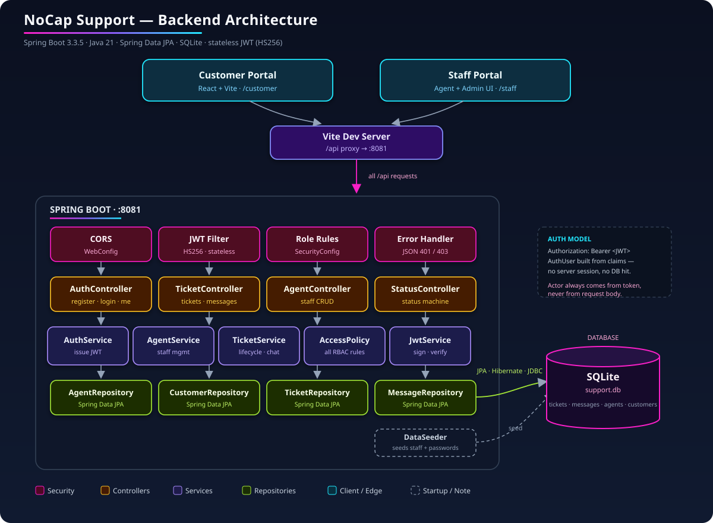
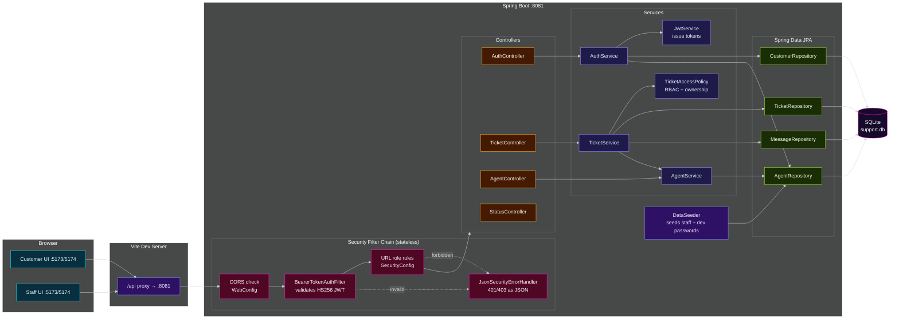
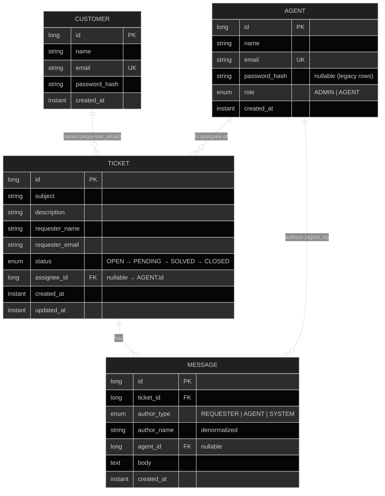
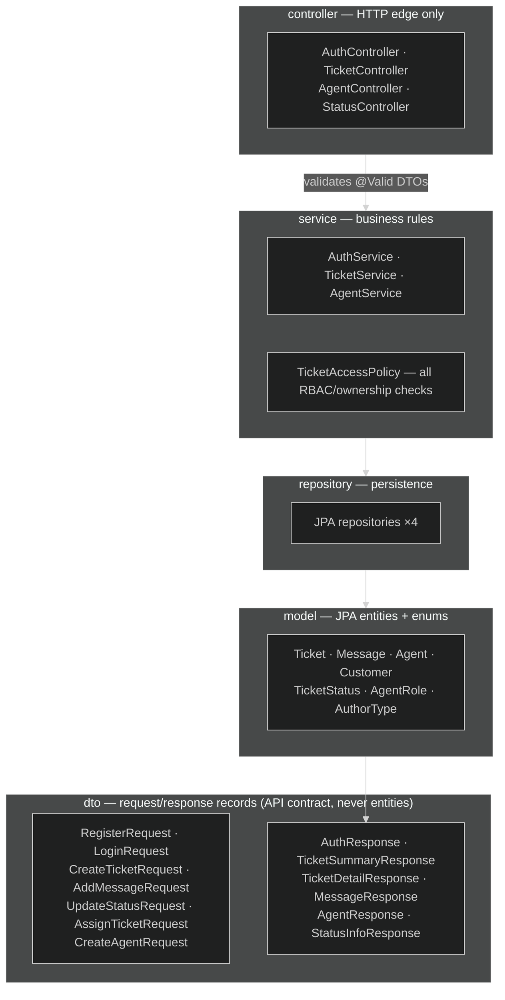
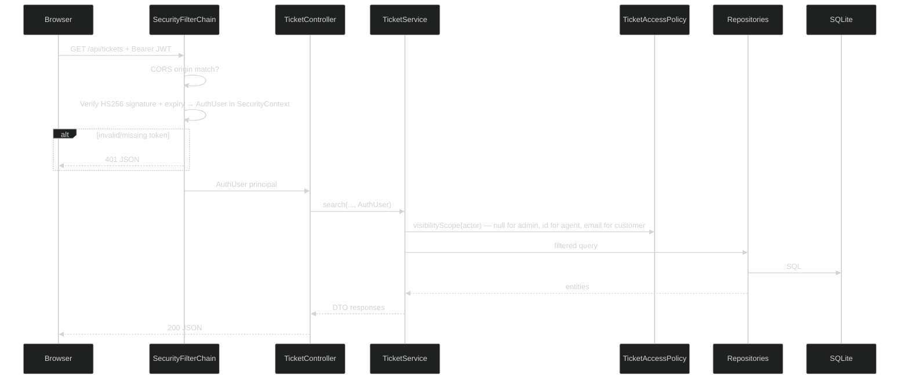

# NoCap Support Backend — Architecture

Spring Boot 3.3.5 · Java 21 · Spring Data JPA · SQLite · Spring Security (JWT).

## System Overview

## Database (ERD)

## Layered Design (MVC)

## Request Lifecycle (authenticated call)

## Design Decisions

### Security

- **Stateless JWT (HS256)** — no sessions; every request carries identity. The `AuthUser` principal (type, id, name, email, role) is reconstructed from claims, so the DB isn't hit on every request for identity.
- **Actor from token, never from body** — request DTOs carry no identity fields. This eliminates spoofing (the old `X-Agent-Id` header trusted the client).
- **Two login surfaces, one token format** — `/auth/login` (customers) and `/auth/staff/login` (agents/admins). Same JWT shape; the `type` claim keeps a staff email from ever being used as a customer session.
- **`TicketAccessPolicy` is a separate class** — every cross-user rule in one place: customers see only their own tickets (other people's tickets return 404, not 403, so existence isn't leaked), agents see own + unassigned and can only claim/release for themselves, **only the assignee can reply** (admins included), admins assign to anyone.
- **BCrypt** password hashing; `JsonSecurityErrorHandler` returns consistent JSON 401/403 instead of HTML.

### Data

- **SQLite** — zero-install, file-based (`support.db`, overridable via `SUPPORT_DB_PATH`). Swap to Postgres by changing only datasource + dialect; repositories are pure Spring Data interfaces.
- **`requester_email` on Ticket instead of a FK to Customer** — tickets survive customer deletion; the customer's identity at ticket-creation is snapshotted (`requester_name` too). Ownership compares against the *token's* email, not a mutable join.
- **`author_name` denormalized on Message** — chat history displays the name the author had at write time; no join needed for the most common query (full thread ordered by `created_at, id`).
- **`SYSTEM` author type** — assignment/status events are written as messages, giving an audit trail inside the same timeline the user reads.
- **`allowedTransitions` computed in `TicketDetailResponse`** — the frontend renders buttons from what the server permits, so the status state machine (`OPEN→PENDING→SOLVED→CLOSED`, reopen allowed) lives only on the backend.

### Config

- **CORS via `allowedOriginPatterns`** with `http://localhost:[*],http://127.0.0.1:[*]` — arbitrary local dev ports allowed, every other origin rejected, overridable via `CORS_ORIGINS`.
- **Seeding via `DataSeeder`** — seeds 3 agents + 1 admin, and backfills `SEED_PASSWORD` onto legacy staff rows lacking `password_hash` (nullable field chosen deliberately so the schema migrates itself with `ddl-auto=update`).
- **Secrets externalized** — `JWT_SECRET` (≥32 bytes), `JWT_TTL`, `SEED_PASSWORD` all have dev defaults only; production must override.

### Error model

- **`ApiException` + `GlobalExceptionHandler`** — services throw semantic errors (`notFound`, `forbidden`, `conflict`, `badRequest`); controllers stay thin. Validation errors return a `fieldErrors` map for form UIs.

### Testing

- `TicketFlowIntegrationTest` — end-to-end flows over MockMvc covering auth, RBAC boundaries, customer ownership, and the full ticket lifecycle against a temp SQLite DB.
